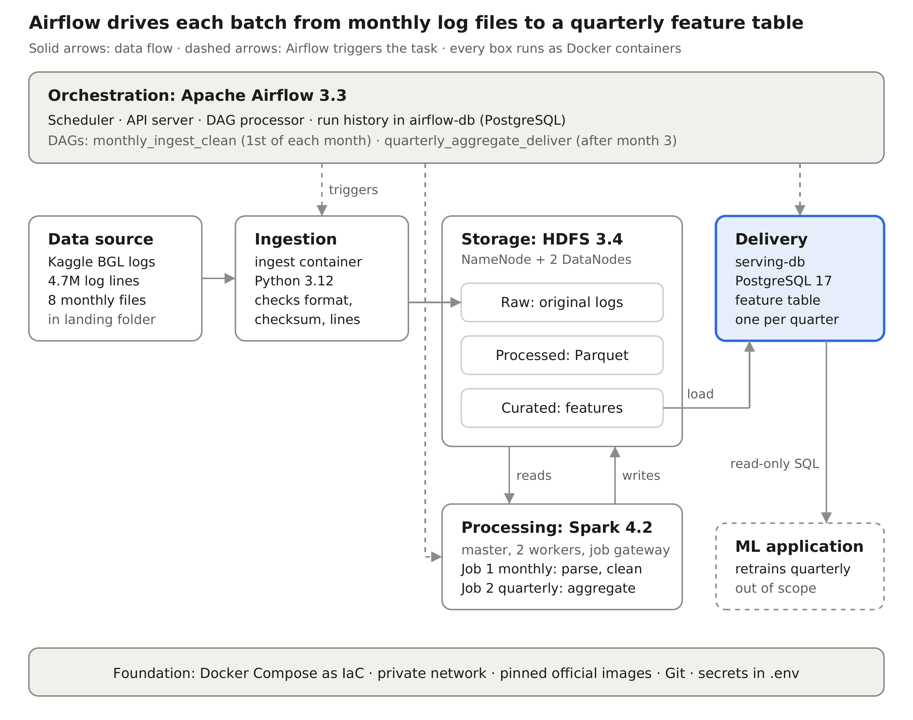

# Batch-processing data architecture for a data-intensive ML application

Portfolio project, Data Engineering (IU). A batch pipeline that takes the **BGL supercomputer log**
(4,747,963 timestamped lines, Loghub / Kaggle), stores it in **HDFS**, cleans it monthly and builds
hourly machine-learning features quarterly with **Spark**, and delivers them to **PostgreSQL**.
**Airflow** runs the steps. Every part runs in its own **Docker** container (`docker-compose.yml`).



## Where the data goes

| Station | Where | Written by |
|---|---|---|
| ① Landing folder | `data/landing/bgl_2005-06.log` … (one file per month) | `ingest/prepare_data.py` (once) |
| ② HDFS raw | `/data/raw/bgl/month=2005-06/` (unchanged copy) | `ingest/ingest_service.py` |
| ③ HDFS processed | `/data/processed/bgl/month=2005-06/` (clean table, Parquet) | `spark/jobs/clean_month.py` |
| ④ HDFS curated | `/data/curated/features/quarter=2005Q3/` (features, Parquet) | `spark/jobs/build_features.py` |
| ⑤ PostgreSQL | table `features.midplane_hourly` (read by the ML application) | `spark/jobs/build_features.py` |

Airflow (`airflow/dags/bgl_pipeline.py`) starts the steps: **monthly** ingest → clean,
**quarterly** wait → delete old rows → build features → check delivery.
Every step writes one line into the audit table `governance.pipeline_runs`.

## How to run (Windows PowerShell, Mac or Linux)

You need **Docker Desktop** with at least 8 GB memory. Run the commands in the project folder.

```bash
# 1. passwords file (once)
copy .env.example .env               # Mac/Linux: cp .env.example .env

# 2. build the images (once, about 5 minutes)
docker compose build

# 3. download the dataset and split it into monthly files (once)
docker compose run --rm ingest python prepare_data.py

# 4. start everything – Airflow then runs the whole pipeline by itself
docker compose up -d
```

Then open **http://localhost:8501** (dashboard) and watch the numbers go to 8 / 8 and 4 / 4
(about 20–60 minutes). Airflow is at **http://localhost:8080** (no login needed).

If step 3 cannot download the file, open
https://zenodo.org/records/8196385/files/BGL.zip?download=1 in your browser, save the file in
the folder `data/download` and run step 3 again.

## Useful commands

| Command | What it does |
|---|---|
| `docker compose ps` | Shows all containers and whether they are healthy |
| `docker compose logs -f airflow` | Shows what Airflow is doing |
| `docker compose stop` | Stops everything, keeps all data |
| `docker compose down -v` | Deletes everything (containers and data) for a fresh start |
| `docker compose exec spark-gateway /opt/spark/bin/spark-submit /opt/tests/test_transform.py` | Runs the unit tests |
| `docker compose exec serving-db psql -U ml_reader -d serving -c "SELECT quarter, count(*) FROM features.midplane_hourly GROUP BY quarter"` | Reads the features like the ML application |

**Coming from the old version?** Run `docker compose down -v --remove-orphans` once before step 4.

## Web pages (only reachable from your own computer)

| Address | What you see |
|---|---|
| http://localhost:8501 | Dashboard: where is my data? |
| http://localhost:8080 | Airflow: pipelines, runs, logs |
| http://localhost:9870 | HDFS: Utilities → Browse the file system → `/data` |
| http://localhost:8090 | Spark: workers and finished jobs |

## Project files

```
docker-compose.yml          all 13 containers (Infrastructure as Code)
.env.example                passwords template (copy to .env, never uploaded to Git)
hdfs/                       HDFS settings (2 copies of every block, permissions)
ingest/prepare_data.py      step 0: download + split into monthly files
ingest/ingest_service.py    copies a monthly file into HDFS
spark/gateway.py            starts a Spark job when Airflow asks
spark/jobs/transform.py     the cleaning and feature logic
spark/jobs/clean_month.py   monthly job:   raw -> processed
spark/jobs/build_features.py quarterly job: processed -> curated + PostgreSQL
spark/tests/                unit tests
airflow/dags/bgl_pipeline.py the two pipelines
postgres/init.sh            tables and users of the serving database
dashboard/app.py            the dashboard
```

## Reliability, security and governance (short)

* HDFS keeps 2 copies of every block; the raw zone is never changed; every job overwrites only its
  own month or quarter, so repeating it is safe; Airflow retries failed steps twice.
* Files with more than 1 % broken lines are rejected (ingest and Spark).
* Private Docker network; web pages only on 127.0.0.1; passwords only in `.env`;
  `ml_reader` may only read the features; HDFS zones belong to user `etl` (mode 750).
* IP addresses, e-mail addresses and user names are masked before data leaves the raw zone.
* Audit table `governance.pipeline_runs` records every step.

## Data source

Zhu, J., He, S., He, P., Liu, J., & Lyu, M. R. (2023). Loghub: A large collection of system log
datasets for AI-driven log analytics. *IEEE ISSRE*. Kaggle: LogHub – BGL Log Data; original
archive: Zenodo record 8196385.
